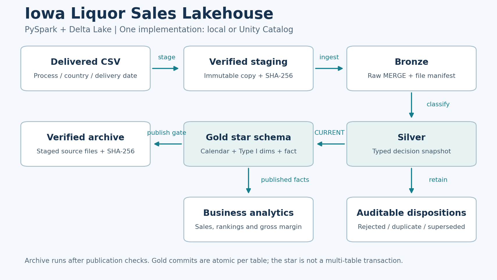

# Iowa Liquor Sales Lakehouse

**PySpark · Spark SQL · Delta Lake · Databricks · Unity Catalog · Medallion Architecture**

A batch data engineering portfolio project that turns delivered Iowa Liquor Sales CSV files into a
validated analytical star schema. It handles repeated deliveries, corrections, late backfills,
conflicting records, quarantine, and verified source archival.

One Python implementation runs against **local Delta tables** or **Unity Catalog**. Notebooks provide
interactive entry points; a versioned Databricks job defines the execution order.



## What the pipeline demonstrates

- **Bronze:** immutable staging, SHA-256 file identity, insert-only raw merges and a persistent file manifest.
- **Silver:** typed records, explicit rejection reasons, deterministic version selection, and complete row accounting.
- **Gold:** Type I store/item dimensions, a calendar dimension, and a unique invoice-line fact table using Delta `MERGE`.
- **Operations:** retry-safe writes, publication checks, content-verified archival and a single-writer job configuration.
- **Analytics:** calendar-based windows, exact prior-year joins, gross margins and descriptive price–volume association.

## Run the example locally

Requires **Python 3.11–3.13**, **Java 17**, and network access for the initial Python/Maven dependencies.
The tested local combination is **Python 3.12, Spark 4.0.1 and Delta Lake 4.0.0**.
Use Python 3.12 for the closest match to CI. Databricks provides Spark and Delta itself; do not install
the `local` extra into a Databricks runtime.

```bash
python -m venv .venv
# Linux/macOS: source .venv/bin/activate
# Windows PowerShell: .\.venv\Scripts\Activate.ps1
python -m pip install -e ".[local,dev]"

python examples/generate_inputs.py --root .state/demo
python -m iowa_lakehouse --local-root .state/demo --process-date 20251018
python -m iowa_lakehouse --local-root .state/demo --process-date 20251018
python -m iowa_lakehouse --local-root .state/demo --process-date 20251019
```

The generator creates **synthetic data**, including a duplicate, rejected records, a quoted multiline
address and a later correction. It does not download or redistribute the Iowa dataset.

| Delivery | Current facts | Published sales | Behavior |
|---|---:|---:|---|
| `20251018` | 3 | USD 270.00 | Six source records: three current, two rejected, one duplicate |
| Same delivery again | 3 | USD 270.00 | Replay retains the published values |
| `20251019` | 4 | USD 366.00 | One existing sale corrected and one sale added |

Dates in this example are delivery identifiers, not default dates in the pipeline.
Source `sale_date` determines Gold's calendar keys and partitions.

```bash
ruff check src tests scripts examples
python scripts/check_notebooks.py
pytest -q
python -m build --wheel
```

The test suite exercises actual Delta writes and merges, including interruption between raw/manifest
commits, failure before publication, partial archive copies, invalid corrections and late backfills.
See [validation scope](docs/validation.md).

## Run on Databricks

The bundle defines **one serverless job** with four dependent tasks:
`bronze → silver → gold → archive`, with `max_concurrent_runs: 1`.

1. Configure Databricks CLI authentication for a workspace with Unity Catalog.
2. Use an existing catalog and empty project schemas. The runtime identity needs privileges to create
   schemas, tables, views and a managed volume, and to read/write their contents.
3. Install the development tools, validate and deploy:

```bash
python -m pip install -e ".[dev]"
databricks bundle validate -t dev
databricks bundle deploy -t dev
```

4. Prepare the managed volume and upload a CSV under the configured delivery path. The exact SQL,
   paths, parameter overrides and notebook instructions are in the [runbook](docs/runbook.md).
5. Run the job with an explicit delivery date:

```bash
databricks bundle run -t dev --params process_date=20251018 iowa_pipeline
```

Catalog/schema/volume defaults are declared in `databricks.yml`; override them for your workspace.
The Databricks deployment requires a workspace validation run. Local tests do not assert cloud
permissions, serverless behavior, or deployment compatibility on a particular workspace.

## Published data model

| Object | Logical key | Purpose |
|---|---|---|
| `gold.dim_time` | `date_key` | Calendar dates and derived attributes |
| `gold.dim_store` | `country, store_id` | Current store attributes, Type I |
| `gold.dim_item` | `country, item_no` | Current product/vendor/category attributes, Type I |
| `gold.fact_sales` | `country, invoice_line_no` | Measures, dimension keys and source lineage |

The fact is partitioned by sale **year/month**, with decimal revenue/cost/volume columns.
Dimensions are published before the fact; foreign-key coverage and source equality are checked.
Type I classification applies current dimension attributes to historical facts.

Silver keeps all observation dispositions in one Delta table, `silver.iowa_records`.
In Unity Catalog, `silver.iowa_clean_v2_strict` and `silver.iowa_rejected` are views over that table.
The views share the same underlying commit, avoiding independent clean/rejected snapshots.

## Design boundaries

- This is a **batch portfolio demonstration**, with a full Silver reconciliation over retained Bronze
  observations. Incremental raw ingestion and fact upserts do not make the Silver scan incremental.
- The supported domain is **positive sales**. Returns/reversals are quarantined. Quality tolerances,
  optional attributes and supported headers are explicit in the [data contract](docs/data_contract.md).
- Delivery date supplies record precedence. Different payloads for a key on its latest delivery date
  are quarantined; file arrival time is not used to invent ordering.
- Input omission is not a source deletion. A later invalid correction removes the corresponding
  current fact when a nonempty valid snapshot can be published. An entirely invalid snapshot blocks publication.
- Delta commits are atomic **per table**. The star's separate dimension/fact writes are not a
  multi-table transaction; readers can observe Type I attribute updates before fact publication.
- Run one writer against a project namespace. The bundled job serializes its own runs; independent
  manual jobs must not write to the same namespace concurrently.
- Performance and large-volume capacity require measurement on the target runtime; no unmeasured
  throughput, latency or production-service guarantees are claimed.

## Explore the project

- [Technical overview PDF](docs/final_project.pdf)
- [Architecture and recovery](docs/architecture.md)
- [Data contract](docs/data_contract.md)
- [Runbook](docs/runbook.md)
- [Validation](docs/validation.md)
- [Business queries notebook](sql/business_queries/4_Business_Queries.ipynb)
- [Idempotency and reconciliation](sql/idempotency/README.md)
- [Implementation](src/iowa_lakehouse/) · [Tests](tests/) · [Databricks job](resources/pipeline.job.yml)

## Dataset and license

Business domain: [Iowa Liquor Sales, Iowa Data Hub](https://data.iowa.gov/catalog/dataset/1051).
The accepted historical export headers are listed in the data contract; adapt other export layouts
explicitly before ingestion. No third-party source dataset is committed.

Project code, documentation and synthetic examples: [MIT License](LICENSE).

**Andres Olguin** · [GitHub](https://github.com/andresolguin)
